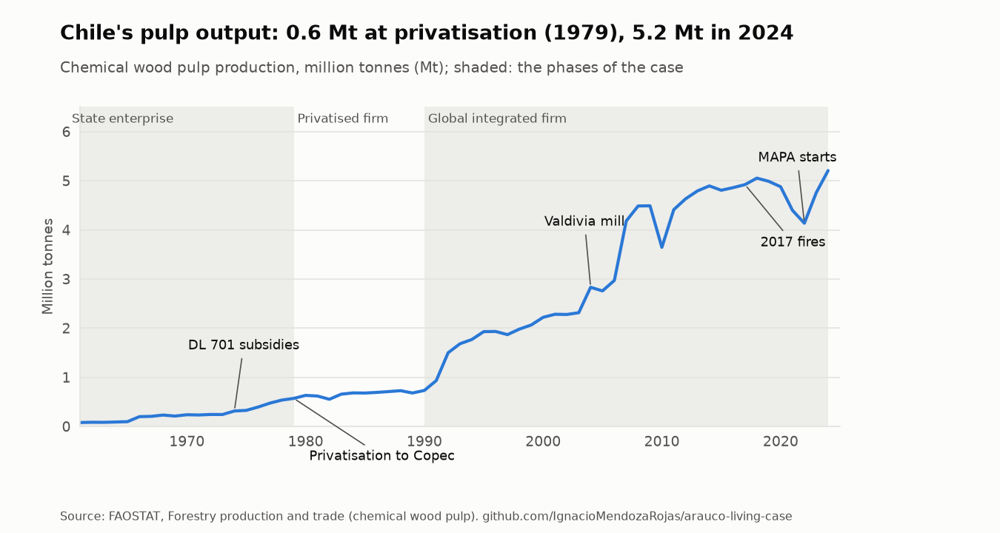

# arauco-living-case

**Business history that keeps itself up to date: Arauco and the Chilean forestry model.** A case that starts from my essay on Arauco and adds to it every month, using public data and the news.

> I wrote a business-history essay on Arauco, from its origin as a state company (CORFO, 1967) to its privatisation into the Angelini group (1979) and its place in the global pulp market. A finished essay goes out of date the day it is handed in. This repository turns it into a living case: a structured timeline, the long-run data, and a monthly log of what happens next. Every sentence in the log is computed from the data.

## Results

_Filled in after the first run._

<picture>
  <source media="(prefers-color-scheme: dark)" srcset="docs/figures/arc-dark.png">
  
</picture>

## Latest reading

<!-- latest:start -->
<!-- latest:end -->

## The questions

1. What role does the Angelini group play in Arauco's strategy, expansion and legitimacy?
2. Do Arauco's technological and industrial investments (such as MAPA) transform the production model or adapt it to survive?
3. How has economic concentration sustained the continuity of Chile's forestry model?

**Working hypothesis.** Sustainability, certification and innovation strategies work mainly as mechanisms of institutional legitimacy that sustain the extractive-export model under growing territorial, environmental and regulatory pressure. The theoretical frame combines the modern business enterprise (Chandler), the technostructure (Galbraith), late industrialisation (Amsden), business groups, extractivism and organisational legitimacy (Suchman; Meyer and Rowan).

The link with [ownership-and-boards](https://github.com/IgnacioMendozaRojas/ownership-and-boards): AntarChile and Empresas Copec, the holding companies above Arauco, are part of that project's Chilean sample, so this case is the long, qualitative view of one ownership chain the other project measures.

## Method

- **Timeline.** The essay's periods and events, as structured data ([`timeline.yaml`](config/timeline.yaml)), each tagged with a theme of the case: state, group, territory, legitimacy.
- **Long-run data.** FAOSTAT forestry statistics for chemical wood pulp: Chile's production, exports and export value since 1961, against the world and the main producers.
- **News.** Headlines from Google News (Chile, Spanish) for Arauco, kept with source, date and link only, and accumulated month after month. Each headline is tagged with the case's themes by transparent keyword rules ([`sources.yaml`](config/sources.yaml)); headlines about the province or the town of Arauco are left out.
- **Research.** Articles on Arauco and Chilean forestry in OpenAlex, listed on the [timeline page](docs/timeline.md).
- **The log.** Each month the update writes a dated entry in the [case log](docs/log.md): the latest data, with its change, and the new headlines by theme.

## Limitations and next steps

- The keyword rules are a first pass; a headline can be misclassified, and the themes are counts of coverage, not of importance.
- Material events filed with the CMF (hechos esenciales) are the natural official source for the log; the CMF search form did not return results to automated requests in the first probes, so it is the next source to add.
- FAOSTAT covers Chile, not Arauco alone; the company's own figures (annual reports, financial statements filed with the CMF) are the next step for firm-level data.

## Automation

[`update.yml`](.github/workflows/update.yml) runs on the 5th of every month and whenever the configuration changes. Run locally with `arauco fetch` and `arauco report`. `ruff` and `pytest` run on every push ([`ci.yml`](.github/workflows/ci.yml)).

## License

MIT. FAOSTAT data are CC BY 4.0; OpenAlex metadata is CC0; headlines link to their publishers.
